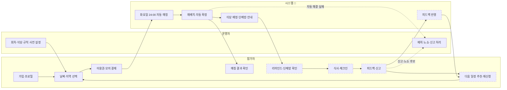
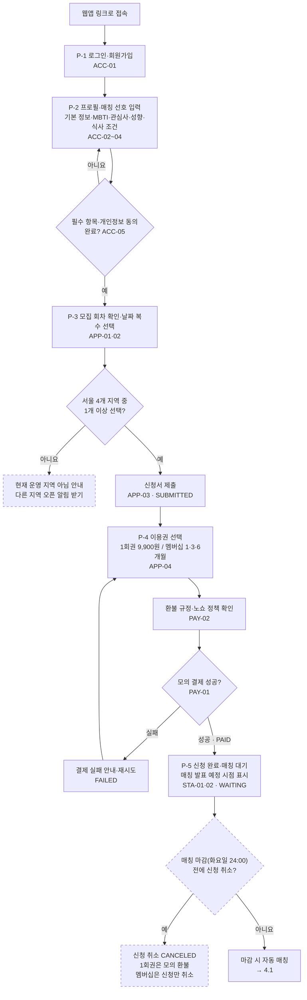
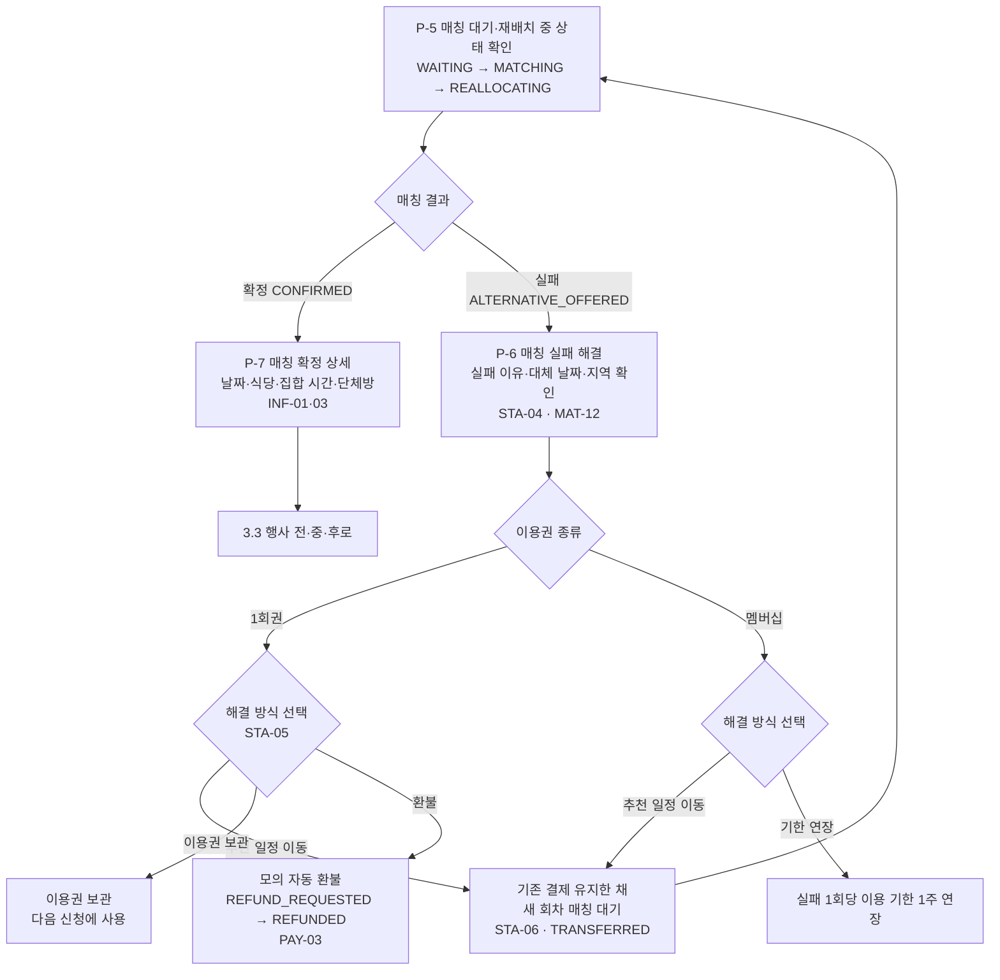
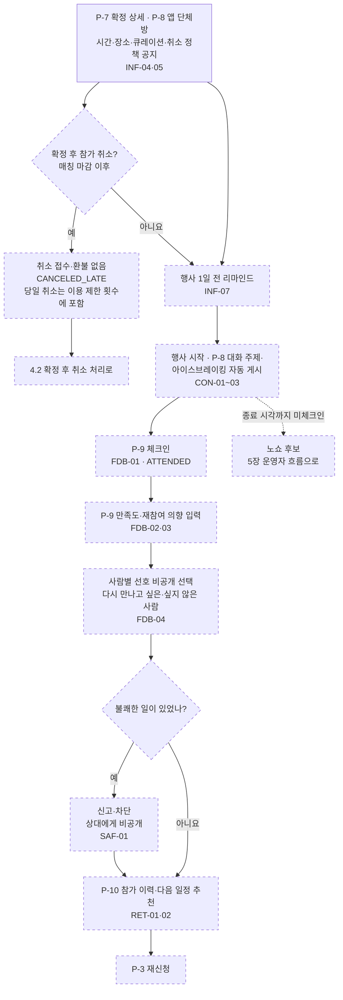
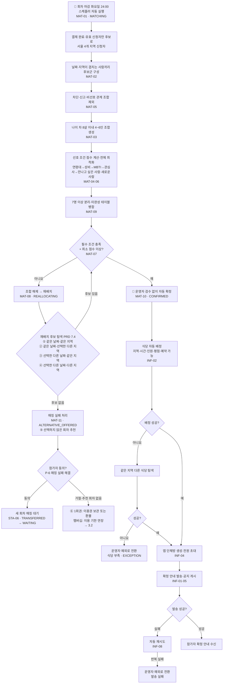
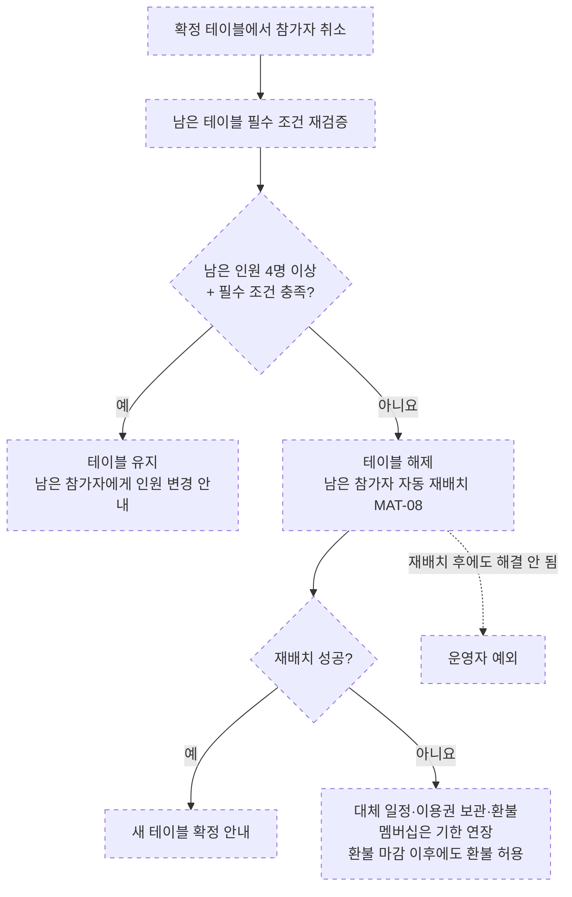
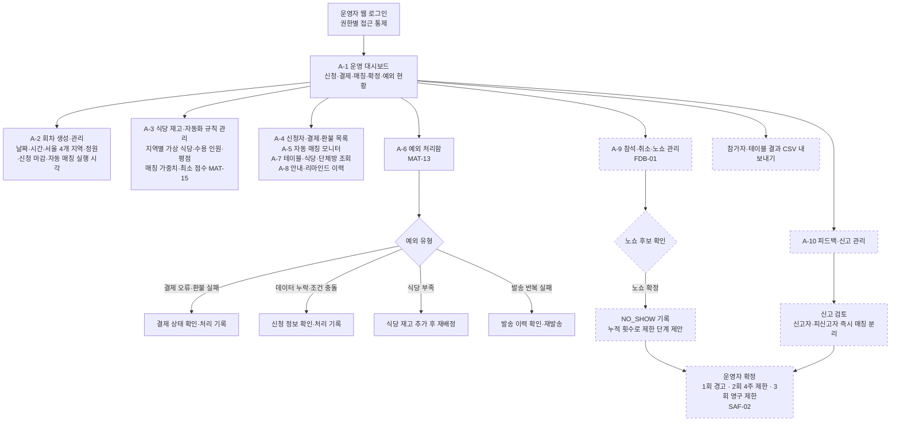
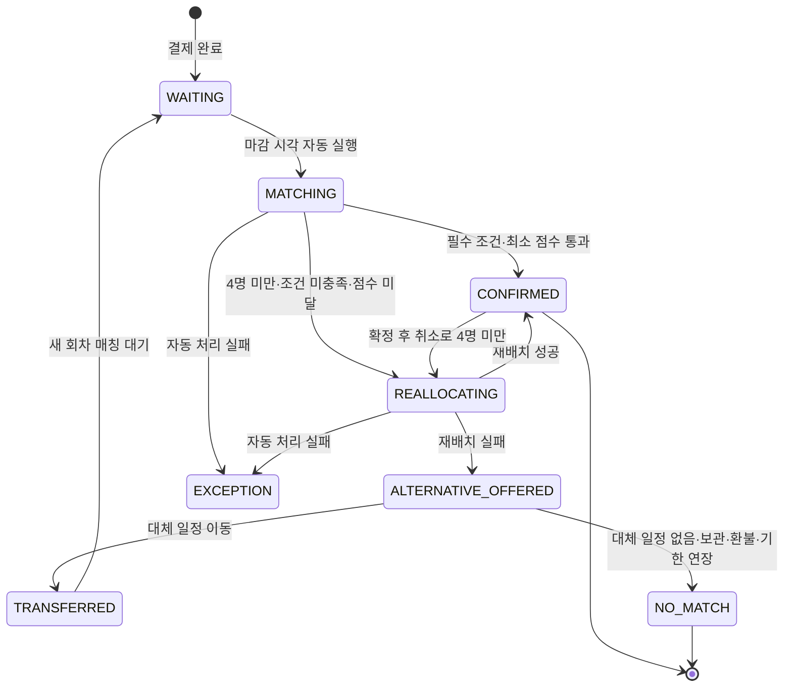
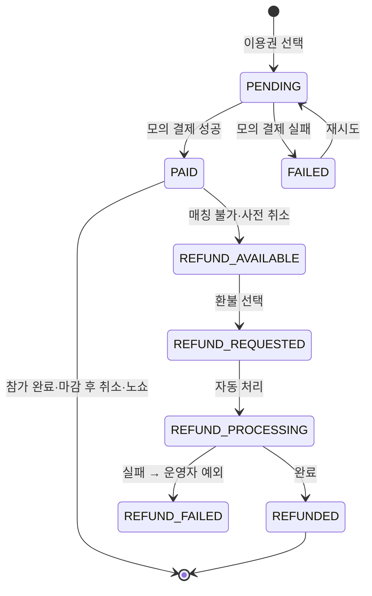

# 사용자 흐름도

## 1. 문서 목적

`MVP_기능_범위.md`의 MVP 전체 범위를 참가자·시스템·운영자 흐름으로 그린다. 각 단계에는 화면 번호(MVP 문서 9장)와 PRD 기능 ID를 붙여, 화면 설계와 구현 순서를 정할 때 기준으로 쓴다.

### 범례

| 표시 | 의미 |
|---|---|
| 실선 상자 | 1단계(첫 시연 필수 흐름) |
| 점선 상자 | 2단계(MVP 완료 범위) |
| 마름모 | 분기 |
| `P-n` / `A-n` | 참가자 앱 화면 n번 / 운영자 웹 화면 n번 (MVP 문서 9장) |
| 🤖 | 운영자 개입 없이 시스템이 자동 처리 |

## 2. 전체 흐름 개요

정상 흐름은 참가자 행동과 시스템 자동 처리만으로 끝나고, 운영자는 사전 설정과 자동 처리되지 않은 예외만 맡는다.

## 3. 참가자 흐름

### 3.1 가입 → 신청 → 결제

- 매칭 마감 전 취소는 이 단계에서만 가능하다. 매칭이 화요일 24:00에 실행되므로, 확정 이후의 취소는 모두 마감 후 취소로 3.3·4.2에서 처리한다.
- 결제 대기(PENDING) 상태로 매칭 마감을 넘기면 매칭 후보에서 빠지고 결제 기한을 안내받는다(PRD 15장).
- 재신청 시 기존 프로필을 불러오는 기능(ACC-06)은 P1이라 MVP 범위 밖이다.

### 3.2 매칭 결과 확인

- 대체 일정도 없으면 매칭 상태는 NO_MATCH가 되고, 1회권은 이용권 보관 또는 환불, 멤버십은 기한 연장으로 처리한다.
- 확정 결과에는 다른 참가자의 상세 개인정보나 점수를 보여주지 않고 제한된 소개만 보여준다(INF-06·MAT-12).

### 3.3 행사 전 → 행사 → 행사 후

## 4. 시스템 자동 처리 흐름

### 4.1 자동 매칭 → 확정 → 안내

- 같은 매칭 작업이 여러 번 실행돼도 테이블·환불·단체방이 중복 생성되지 않아야 한다(PRD 7.3).
- 재배치 중에도 연령·차단·신고 등 필수 조건은 완화하지 않고, 한 참가자를 두 테이블에 동시에 배치하지 않는다.

### 4.2 확정 후 취소 처리 (2단계)

- 대기자 자동 충원(STA-07)은 P1이라 MVP에서 제외한다.

## 5. 운영자 흐름

- 1단계에서는 가중치·최소 점수를 초기값(최소 55점)으로 고정하고, 설정 화면(A-3의 MAT-15 부분)은 2단계에서 만든다.
- 운영 대시보드의 상세 지표는 2단계에서 채운다. 1단계에서는 자동 처리 결과와 예외 목록 확인이 우선이다.

## 6. 상태 전이

PRD 12장에 따라 상태를 하나로 합치지 않고 분리해 저장한다. 아래는 흐름에서 가장 많이 바뀌는 매칭 상태와 결제 상태다.

### 6.1 매칭 상태

### 6.2 결제 상태

## 7. 흐름 단계와 화면·기능 대응

| 흐름 단계 | 화면 | PRD ID | 구현 단계 |
|---|---|---|---|
| 로그인·프로필 | P-1, P-2 | ACC-01~05 | 1단계 |
| 회차·날짜·지역 선택, 신청 | P-3 | APP-01~03 | 1단계 |
| 이용권·모의 결제 | P-4 | APP-04, PAY-01·02 | 1단계 |
| 매칭 대기·재배치 상태 | P-5 | STA-01~03, MAT-12 | 1단계 |
| 자동 매칭·재배치·확정 | (시스템) | MAT-01~11 | 1단계 |
| 매칭 실패 해결 | P-6 | STA-04~06, PAY-03 | 1단계 |
| 확정 상세·식당·단체방 | P-7, P-8 | INF-01~06, INF-08 | 1단계 |
| 회차·식당 설정, 결과 조회, 예외 처리 | A-1~A-8 | MAT-13 | 1단계 |
| 리마인드·대화 콘텐츠 | P-8 | INF-07, CON-01~03 | 2단계 |
| 체크인·피드백·신고 | P-9 | FDB-01~04, SAF-01 | 2단계 |
| 참가 이력·다음 일정 추천 | P-10 | RET-01·02 | 2단계 |
| 확정 후 취소 처리 | (시스템) | MAT-08 | 2단계 |
| 가중치·최소 점수 설정 | A-3 | MAT-15 | 2단계 |
| 노쇼·이용 제한·신고 검토 | A-9, A-10 | FDB-01, SAF-02 | 2단계 |
| 다른 지역 오픈 알림 (선택) | P-3 | — (팀 결정) | 2단계 |

## 참고 자료

- `MVP_기능_범위.md` — 기능 범위, 운영 정책, 화면 목록, 구현 단계
- `우연한식탁_PRD.pdf` — 5장 핵심 사용자 흐름, 7장 매칭 로직, 12장 상태값, 14·15장 알림·예외 처리, 17장 화면 목록
