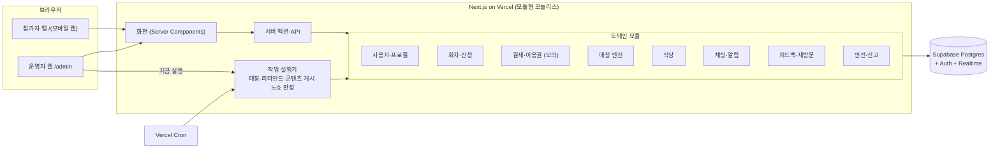
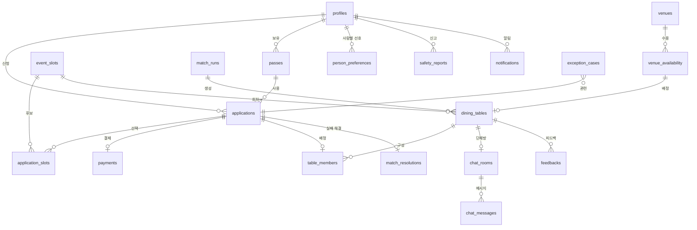

# 시스템 설계

## 1. 문서 목적

`MVP_기능_범위.md`와 `사용자_흐름도.md`를 실제 구현으로 옮기기 위한 설계다. 온보딩 자료의 원칙("기술 스택보다 먼저 상태와 책임을 분리한다", "모듈형 모놀리스로 시작")을 따르고, 제출 마감(10월 21일 23:59)까지 배포 가능한 수준으로 범위를 잡는다.

## 2. 기술 스택

| 구분 | 선택 | 이유 |
|---|---|---|
| 앱 | Next.js (App Router, TypeScript) | 참가자 모바일 웹과 운영자 웹을 한 프로젝트에서 만든다 |
| 배포 | Vercel | 저장소를 연결하면 배포 링크가 바로 나온다 (제출 조건) |
| DB·로그인 | Supabase (Postgres, Auth) | 상태 이력·관계 데이터를 SQL로 다루고, 테스트 계정 로그인을 쉽게 만든다 |
| 단체방 | Supabase Realtime (안 되면 짧은 주기 새로고침) | 앱 내 단체방(INF-04) |
| 예약 실행 | Vercel Cron + 운영자 "지금 실행" 버튼 | 화요일 24:00 자동 매칭(MAT-01). 시연 때는 버튼으로 즉시 실행 |

- Vercel Cron은 요금제에 따라 실행 횟수·정확도 제한이 있으므로 설정 전에 확인한다. 정확한 시각에 의존하지 않도록 "실행 시각이 지났는데 아직 안 돈 회차"를 찾아 실행하는 방식으로 만든다.
- 비밀값(Supabase 키, Cron 보호용 비밀값)은 Vercel 환경 변수로만 관리한다.

## 3. 아키텍처



- **도메인 모듈**은 폴더로 나누고, 화면은 모듈의 함수만 부른다. 다른 모듈의 테이블을 직접 고치지 않는다.
- **작업 실행기**는 예약 작업 4종(자동 매칭, 행사 1일 전 리마인드, 행사 시작 콘텐츠 게시, 종료 후 노쇼 후보 판정)을 같은 방식으로 돌린다. Cron과 운영자 버튼이 같은 함수를 호출한다.
- **모든 상태 변경**은 `status_history`에 시간·변경 주체(시스템/운영자/참가자)와 함께 남긴다(PRD 16장).

### 폴더 구조 (초안)

```
app/
  (participant)/        참가자 화면: profile, apply, pass, home, resolve, tables, chat, notifications, feedback, history
  admin/                운영자 화면: dashboard, slots, venues, applications, matching, exceptions, tables, messages, attendance, safety
  api/cron/[job]/       예약 작업 진입점 (비밀값 확인 후 작업 실행기 호출)
modules/
  profile/  slot/  payment/  matching/  venue/  chat/  notification/  feedback/  safety/
  jobs/                 작업 실행기
lib/supabase/           DB 클라이언트, 권한
supabase/migrations/    스키마
scripts/seed/           가상 데이터 적재
```

## 4. 데이터 모델

PRD 13장 데이터 항목과 12장 상태값을 테이블로 옮겼다. 상태는 PRD대로 신청·결제·매칭·참석을 **별도 컬럼**으로 둔다.



### 4.1 테이블

| 테이블 | 핵심 컬럼 | PRD |
|---|---|---|
| `profiles` | user_id(Auth), 이름, 연락처, 출생연도, 성별, 직업, mbti, interests[], self_traits[], wanted_traits[], 가격대[], 못 먹는 음식, 동의 시각, role(participant/admin), 계정 상태(제한 단계 포함) | User, Profile |
| `event_slots` | 날짜, 시간, 지역(4개 중 하나), 정원, apply_deadline, match_at, status | EventSlot |
| `applications` | user_id, pass_id, **application_status**, **payment_status**, **match_status**, **attendance_status**, 재배치 횟수, 최종 배치 사유 | Application |
| `application_slots` | application_id, slot_id (참가자가 고른 날짜×지역 조합) | Application의 회차 후보 |
| `passes` | user_id, type(1회권/멤버십 1·3·6개월), 가격, valid_until, 연장 횟수, 보관 여부 | 이용권 |
| `payments` | application_id, 금액, 상태(모의), 환불 금액·시각, idempotency_key | 결제 |
| `match_runs` | 실행 시각, 대상 match_at 묶음, 후보자 수, 생성·분리·병합·재배치·확정·실패 수, 실패 사유 요약, 알고리즘 버전, 적용 가중치·최소 점수 | MatchRun |
| `dining_tables` | match_run_id, slot_id, 인원, 조건별 점수(json), 총점, 확정 여부·시각, 재배치 이력(json), venue_availability_id | DiningTable |
| `table_members` | table_id, application_id(**활성 배정은 1개만**, 유니크 제약) | — |
| `venues` / `venue_availability` | 식당명, 지역, 주소, 지도 링크, 가격대, 평점 / 날짜·시간별 수용 인원, 예약 상태 | Venue |
| `chat_rooms` / `chat_messages` | table_id / 보낸 사람(참가자·시스템), 종류(공지·리마인드·콘텐츠·일반), 내용, 발송 결과 | ChatRoom |
| `match_resolutions` | application_id, 추천 회차 목록, 참가자 선택(이동·보관·환불·기한 연장), 처리 상태 | MatchResolution |
| `exception_cases` | 유형(결제·데이터·조건 충돌·식당 부족·발송 실패·환불 실패), 관련 신청·테이블, 실패 사유, 처리 상태, 운영자 조치·메모, 처리자 | ExceptionCase |
| `feedbacks` | table_id, user_id, 분위기·대화·식당 점수, 재참여·추천 의향 | Feedback |
| `person_preferences` | from_user, to_user, 종류(다시 만나고 싶음/다시 만나고 싶지 않음), 비공개 | FDB-04 |
| `safety_reports` / `user_blocks` | 신고자, 피신고자, 사유, 처리 상태, 운영자 조치 / 차단 관계 | SafetyReport |
| `notifications` | user_id, 템플릿 키, 내용, 예약 시각, 읽음 여부, 발송 결과·재시도 횟수 | Notification |
| `matching_settings` | 가중치 6개, 최소 점수(초기 55), 범위(서비스 전체/회차) | MAT-15 |
| `status_history` | 대상(테이블명·id), 이전·이후 상태, 변경 주체, 시각, 사유 | 16장 기록·추적 |

### 4.2 권한 (Supabase RLS)

- 참가자는 **자기 행만** 읽고 쓴다(프로필, 신청, 이용권, 알림, 피드백).
- 같은 테이블 참가자에게는 이름과 제한된 소개만 보이는 **뷰**를 따로 만든다. 연락처·출생연도·사람별 선호·신고는 노출하지 않는다(INF-06, 16장).
- 운영자(role = admin)만 운영자 화면 데이터에 접근한다.
- 매칭·환불 같은 시스템 작업은 서버에서 서비스 키로만 실행한다.

## 5. 매칭 엔진 구현 메모

규칙은 `MVP_기능_범위.md` 5장과 PRD 7장을 따른다. 아래는 구현 방법이다.

1. **실행 단위**: `match_at`이 같은 회차들(같은 목요일의 4개 지역)을 한 번에 실행한다. 지역 간 재배치(PRD 7.4의 ②)가 가능하도록 하기 위해서다.
2. **후보**: 결제 완료(PAID) + 신청 완료(SUBMITTED) + 매칭 대기(WAITING) + 이용 제한이 없는 신청 중 이번 실행 회차를 고른 신청.
3. **제외 관계**: 차단, 신고, "다시 만나고 싶지 않은 사람"을 쌍 목록으로 미리 만든다.
4. **조합**: 지역별 후보를 나이순으로 정렬해 8살 범위 안에서 테이블을 채운 뒤, 점수가 낮은 테이블끼리 사람을 바꿔 보는 단순 개선을 몇 번 반복한다. 가상 데이터 시뮬레이션(MVP 5장)과 같은 방식이다.
5. **검증·확정**: 4~6명 + 필수 조건 + 최소 점수를 통과한 테이블만 한 트랜잭션 안에서 확정하고, 식당 배정·단체방 생성·알림 예약까지 이어서 처리한다.
6. **실패 처리**: 이번 실행에서 못 들어간 사람 중 **나중 날짜도 골랐다면** 그 날짜 회차의 후보로 남는다(재배치 ③④). 고른 날짜가 모두 끝났으면 ALTERNATIVE_OFFERED로 바꾸고 미선택 회차를 추천한다.
7. **중복 방지**: `match_runs`에 실행 묶음별 유일 키를 두고, 상태 변경은 "이전 상태가 맞을 때만" 바꾼다. 같은 실행을 두 번 눌러도 테이블·단체방·환불이 두 번 생기지 않는다(PRD 7.3).

## 6. 시연용 장치

행사 시각이 실제로 올 때까지 기다릴 수 없으므로 운영자 웹에 **시연 도구**를 둔다. 실제 운영 기능과 같은 함수를 부른다.

- 회차별 **"지금 매칭 실행"**
- **"리마인드 발송"**, **"대화 콘텐츠 게시"**, **"행사 종료 처리(노쇼 후보 판정)"**
- **시드 데이터**: `우연한식탁_가상데이터.xlsx`에서 서울 4개 지역 응답 291명을 프로필·신청으로 적재하고, 전원 모의 결제 완료로 둔다. 결제 대기 등 다른 상태는 일부를 바꿔 만든다.
- **테스트 계정**: 참가자 계정 몇 개와 운영자 계정 1개. 제출 메시지에 함께 적는다.
- **2회차 시나리오**(PRD 18장 11번): 1회차 매칭 → 피드백·비선호 입력 → 2회차 매칭에서 새로운 사람 우선과 비선호 제외가 반영되는 것을 보여 준다.

## 7. 개발 일정 (10월 17일 ~ 21일)

인원과 역할에 맞게 나눠 쓴다. 날짜별로 그날 끝나면 배포까지 확인한다.

| 날짜 | 목표 | 범위 |
|---|---|---|
| 10/17 (금) | 기반 | 저장소·Vercel·Supabase 연결, 스키마 마이그레이션, 시드 스크립트, 테스트 계정 로그인, 배포 링크 확보 |
| 10/18 (토) | 신청 흐름 | P-2 프로필, P-3 일정·지역, P-4 이용권·모의 결제, P-5 홈 상태, 앱 내 알림 / A-2 회차, A-3 식당 |
| 10/19 (일) | 매칭·안내 (45점 구간) | 매칭 엔진·재배치·자동 확정, 식당 배정, 단체방·공지, 확정·실패 알림 / A-5 매칭 모니터, A-6 예외 처리함 |
| 10/20 (월) | 실패 해결·피드백 (15점 구간) | P-6 일정 이동·보관·환불·기한 연장, 확정 후 취소 / 리마인드·대화 콘텐츠, 체크인·피드백·신고, 2회차 반영 |
| 10/21 (화) | 운영·마무리 | A-1 대시보드 지표, 노쇼·이용 제한, 신고 검토, 시연 도구 점검, 전체 시나리오 리허설, **23:59 전 제출** |

- 심사 항목 "프로젝트 기록"(10점)을 위해 매일의 계획·진행을 Blaybus Workspace에 남긴다. 지금까지 만든 문서(이해관계자, MVP 범위, 흐름도, 와이어프레임, 이 설계)도 기록으로 올린다.
- 일정이 밀리면 2단계 안에서도 **피드백 수집과 다음 매칭 반영**(15점)을 먼저 지키고, 대시보드 지표와 CSV 내보내기를 뒤로 미룬다.

## 참고 자료

- `우연한식탁_PRD.pdf` — 7장 매칭 로직, 12장 상태값, 13장 데이터 항목, 16장 비기능 요구사항, 18장 해커톤 완료 조건
- `우연한식탁_CTO_온보딩_오리엔테이션 (1).pdf` — 도메인 경계, 모듈형 모놀리스, 스케줄러·이력 기록
- `우연한식탁_해커톤_킥오프슬라이드.pdf` — 일정(10/21 23:59 제출), 심사 기준
- `MVP_기능_범위.md`, `사용자_흐름도.md`, 와이어프레임 캔버스
